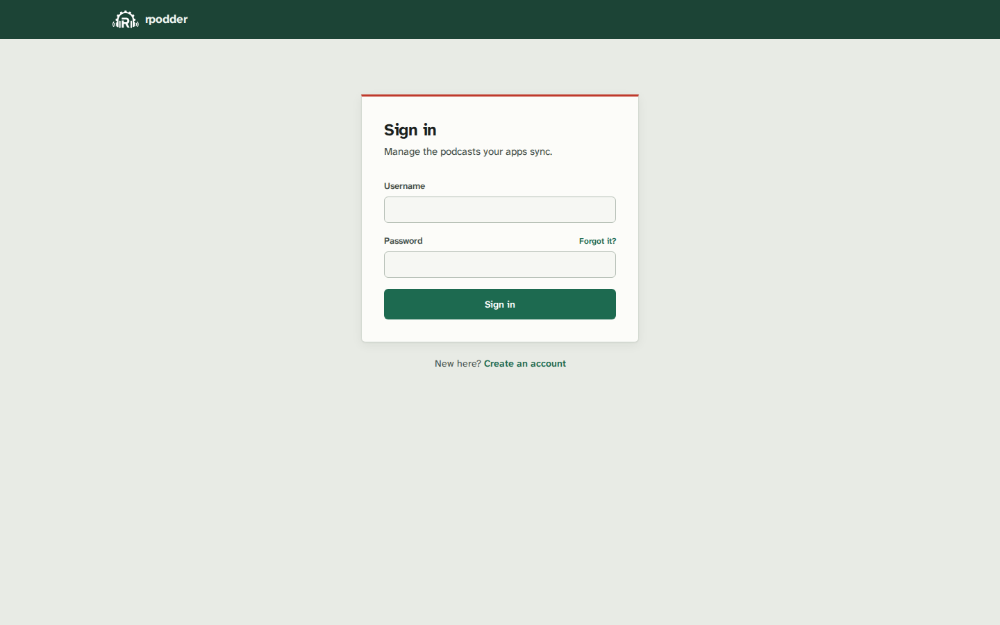
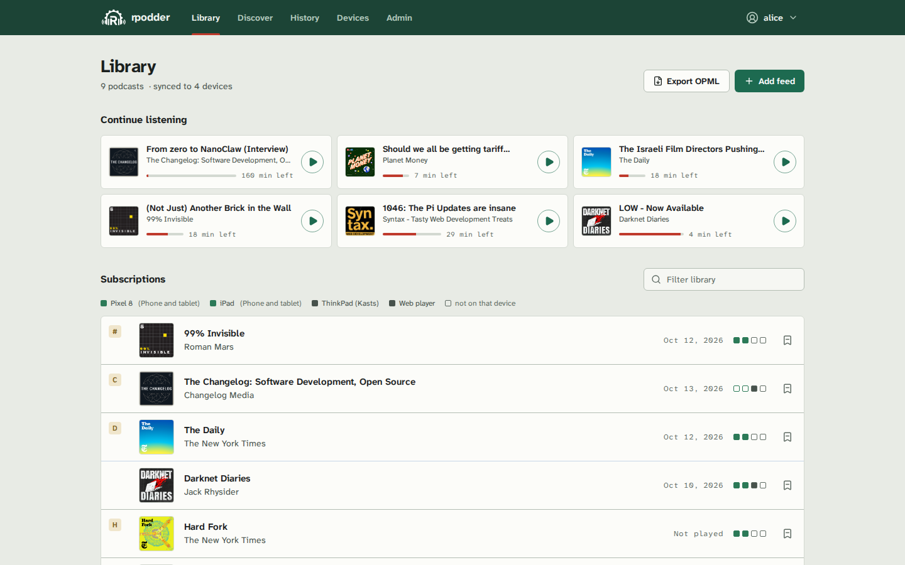
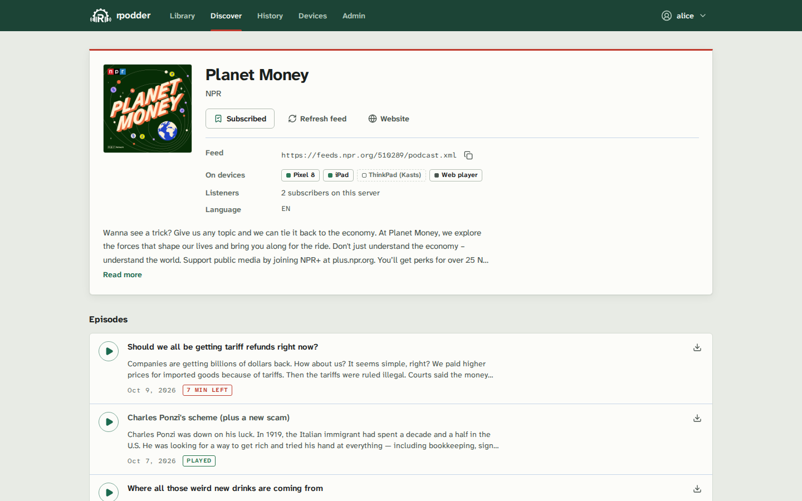
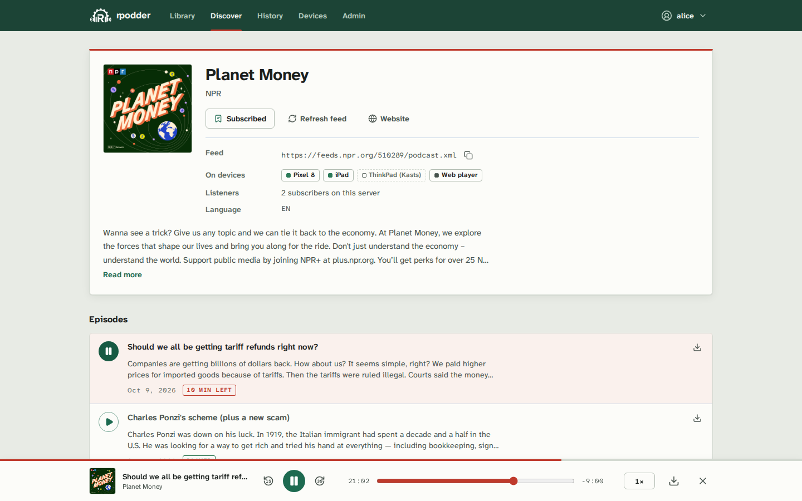
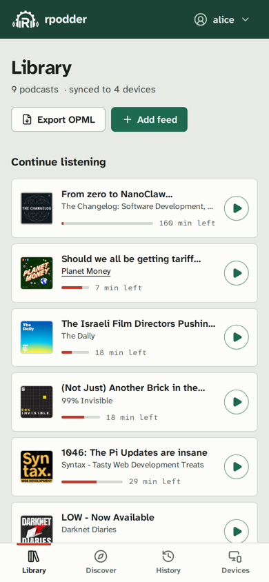
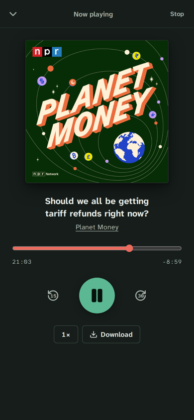
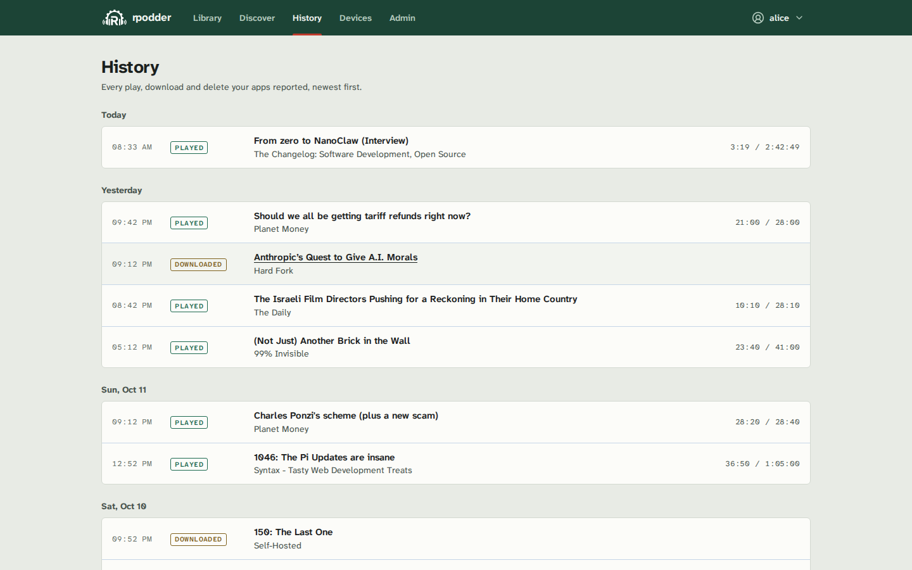
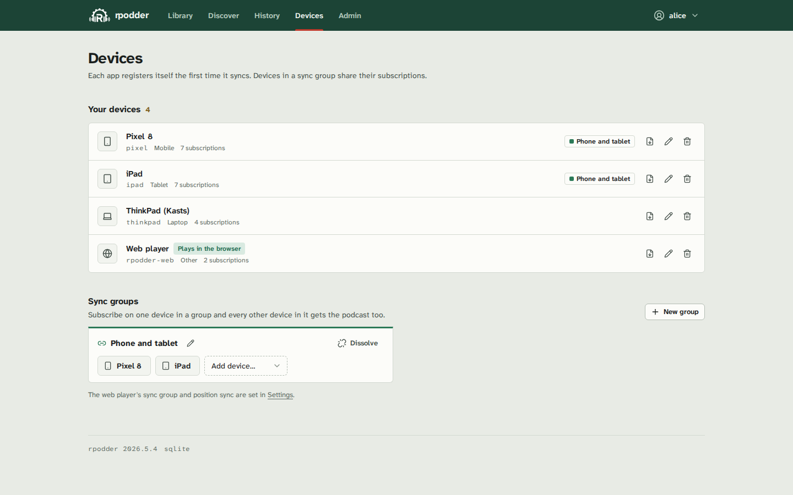
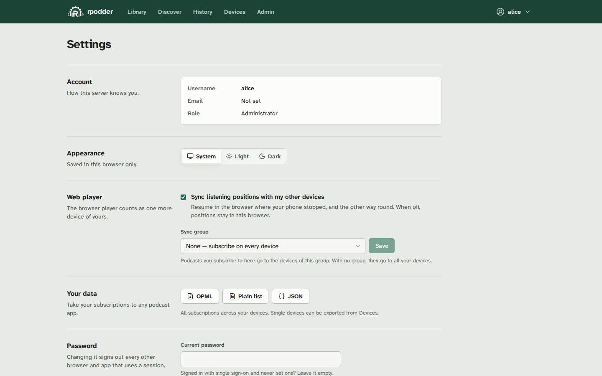
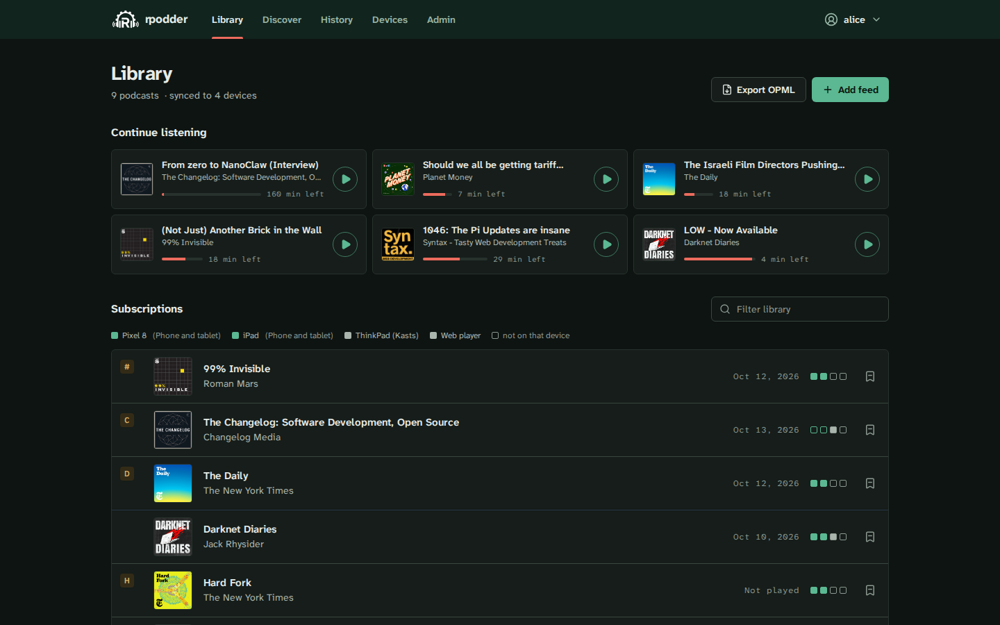

# Web Interface

rpodder includes a built-in web interface built with Svelte 5 and Tailwind CSS v4. It's embedded directly in the binary via `rust-embed`, so there's nothing extra to deploy. Fonts and icons are bundled too: the interface makes no requests to outside services except for podcast artwork and episode audio, which come straight from the publishers.

## Navigation

The green bar at the top holds:

- **Library**: your subscriptions and what you were listening to (home page once signed in)
- **Discover**: search, popular, trending and categories
- **History**: every play, download and delete your apps reported
- **Devices**: your sync devices and sync groups
- **Admin**: the admin panel (administrators only)
- **Your username**: a menu with **Settings**, the documentation, the light/dark theme switch, and **Log out**

On a phone the sections move to a tab bar at the bottom of the screen, and **Admin** moves into the account menu.

## Pages

### Library

Your subscriptions in alphabetical order, filed under their first letter (leading "The", "A" and "An" are ignored). Above them, **Continue listening** shows episodes you started and didn't finish, on any device, with how much is left. The bars are drawn to scale, so a longer episode has a longer bar.

Next to each podcast, one small square per device shows where it is subscribed. A filled square means the device holds the podcast; devices in the same sync group share a colour. The legend above the list names the devices and their groups. A filter box appears once your library has more than eight podcasts.

From the Library you can:

- **Add feed**: subscribe to a podcast by its RSS or Atom address, including private feeds with a token in the URL. rpodder then opens the podcast and reads its episodes.
- **Export OPML**: download all your subscriptions as an OPML file any podcast app can import. Each entry carries the podcast title.
- **Unsubscribe**: the bookmark button on each row. rpodder asks for confirmation and names the devices it will remove the podcast from.

If any subscription uses HTTP and an HTTPS address exists, a notice offers to switch it (or all of them) to HTTPS.

### Podcast page

The header is the podcast's catalog card:

- **Feed**: the feed address, with a copy button.
- **On devices**: which of your devices hold the podcast.
- **Listeners**: how many people on this server subscribe, and the language.

**Subscribe** / **Subscribed** toggles your subscription. **Refresh feed** re-reads the feed immediately and is shown to administrators only. **Website** opens the publisher's site.

Each episode shows its date, its length (drawn to scale against the other episodes on the page), a **download** button for the audio file, and a stamp when you have played it or how many minutes are left.

### Discover

Three tabs:

- **Browse**: a search box that looks in this server's directory and, when configured, in [Podcast Index](https://podcastindex.org). Paste a feed address instead of a search term to subscribe to it directly. Below the search: popular podcasts, a few categories, and all category tags.
- **Top podcasts**: the podcasts with the most subscribers on this server.
- **Trending**: what is trending on Podcast Index, filtered by language (All, English, Italiano, Deutsch, Español, Français).

### Listening in the browser

On a podcast's page (signed in), each episode with an audio file has a **play** button. Playback continues in the player bar at the bottom while you browse other pages. The bar shows progress as a red line along its top edge, and has skip back 15 s / forward 30 s, a seek bar, playback speed, download and close.

On a phone the bar is compact: tap it to open the full **Now playing** screen with large controls.

If an episode can't play (the file is missing, or it is only available over plain HTTP while rpodder runs on HTTPS), the player shows an **Open file** button to play it in a new tab instead.

Only one browser tab plays at a time: starting playback in another tab pauses the first.

### Syncing with your other devices

The web player is a sync device called **Web player** (`rpodder-web`). In **Settings → Web player**:

- **Sync listening positions**: when on, the player resumes where your phone stopped and your phone can resume where the browser stopped. When off, positions stay in this browser only.
- **Sync group**: add the web player to one of your sync groups so it shares subscriptions with those devices. Joining merges subscriptions both ways and can't be undone.

**Subscribe** from the web UI goes to the web player and its sync group when it has one; otherwise it goes to all your devices. **Unsubscribe** removes the podcast from every device that has it, after asking you to confirm.

!!! note
    Older versions of the web UI used a device called `web` when you had no devices yet. It is now an ordinary device; delete it on the Devices page if you don't use it.

### History

Your episode actions grouped by day, newest first: the time, a stamp for the action (Played, Downloaded, Deleted, Marked new), the episode and podcast, and the position reached. Click an entry to open the podcast.

### Devices

Every device that synced with rpodder, with its id, type and number of subscriptions. For each device you can:

- **Export OPML** of that device's subscriptions only
- **Rename** it (the name shown in the UI; the id the app uses doesn't change)
- **Remove** it, together with its subscription list on the server (the app registers again the next time it syncs)

**Sync groups** keep the subscriptions of several devices identical. Create a group from two or more devices that aren't in a group yet, rename it, add or remove devices, or dissolve it. Dissolving keeps each device's current subscriptions.

### Settings

- **Account**: username, email and role.
- **Appearance**: System (follows your operating system), Light or Dark. Saved in this browser only.
- **Web player**: position sync and sync group, see above.
- **Your data**: download all your subscriptions as OPML, a plain list of URLs, or JSON.
- **Password**: change your password. Changing it signs out every other browser and app that uses a session. Leave "Current password" empty only if you signed in with single sign-on and never set one.

### Admin Panel

See the [Admin Guide](../admin-guide/user-management.md) for details.

## Themes

The interface has a light and a dark theme. By default it follows your operating system; pick one in the account menu or in **Settings → Appearance**.

## Mobile

The interface works on phones: navigation moves to a bottom tab bar, lists stack, and the player opens full screen. For background playback and downloads, a dedicated app like AntennaPod with rpodder as the sync backend is still the better choice.
